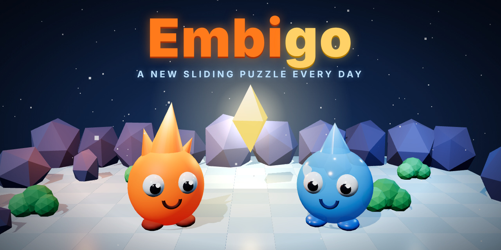

<p align="center">
  
</p>

# Embigo

A daily 3D sliding puzzle. Guide **Embi** the fire sprite and **Drip** the water sprite across icy caves: a creature keeps sliding until something stops it. A new puzzle every day, the same for everyone, with a leaderboard.

**Play it: https://embigo.asciosh.workers.dev

## How to play

- Slide to the glowing diamond. Fewer moves is better: can you match the par?
- Rocks stop everyone.
- **Embi** burns bushes, but lakes are walls for Embi.
- **Drip** swims across lakes, but bushes are walls for Drip.
- Controls: arrow keys or WASD (swipe on a phone). `R` restart, `N` new random puzzle, `T` today's puzzle, `L` leaderboard.

## Features

- Procedurally generated puzzles from a seed. Every puzzle is solvable: a breadth-first-search solver checks it and measures the par.
- A puzzle of the day, identical for everyone in the world (UTC).
- 3D scene built with Three.js. The creatures are made from simple shapes, no external models.
- Leaderboard with nickname and 4-digit PIN (no email). Scores are verified on the server by replaying the submitted moves on the real puzzle, so they cannot be faked.

## Tech stack

TypeScript, Vite, Three.js, Cloudflare Workers and D1.

## Project structure

| Path | What it does |
|---|---|
| `src/game.ts` | Pure game rules (no drawing). Shared by the browser and the server |
| `src/generator.ts` | Seeded level generator and solver |
| `src/scene.ts`, `src/creatures.ts` | 3D scene and creature models |
| `src/main.ts`, `src/api.ts` | Interface, input, leaderboard client |
| `worker/index.ts` | API: accounts, score verification, leaderboard |
| `schema.sql` | D1 database schema |
| `scripts/make-puzzles.ts` | Pre-generates the daily puzzles |

## Development

```bash
npm install
npm run dev
```

`npm run dev` runs the game only. To try the leaderboard locally as well:

```bash
npx wrangler d1 execute embigo-db --local --file=schema.sql
npm run build
npx wrangler dev
```

## Status

Playable and online. More creatures and sounds are planned.
